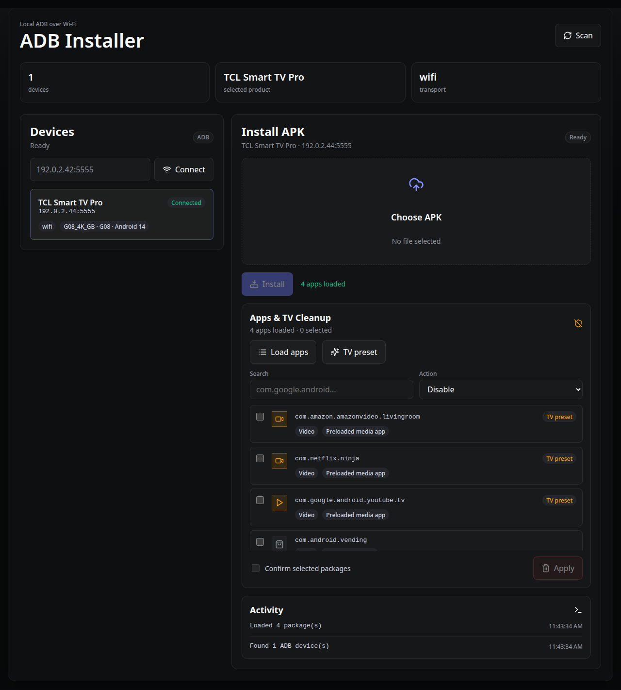

# ADB Installer

Local web app for discovering Android devices over Wi-Fi, identifying connected products, installing APK files, and reviewing Android TV packages for safe disable or user-level uninstall actions.



## Requirements

- Bun
- Android SDK Platform-Tools (`adb`) available on `PATH`
- Android device with wireless debugging or TCP ADB enabled

## ADB binary

This repo does not bundle `adb` binaries for macOS, Linux, or Windows. The server runs the `adb` command from your system `PATH`, so install Android SDK Platform-Tools for your operating system first:

- Official download: <https://developer.android.com/tools/releases/platform-tools>
- Verify: `adb version`

Bundling `adb` per OS would make the repo larger and stale quickly. Keeping `adb` external lets you update Platform-Tools independently when Android changes wireless debugging behavior.

## Enable ADB over Wi-Fi on Google TV

Menu labels vary by Google TV / Android TV version. Some devices call this `Wireless debugging`; many TVs call it `Network debugging`.

1. Put the computer and TV on the same local network.
2. On the TV, open `Settings` > `System` > `About`.
3. Select `Android TV OS build` several times until Developer options are enabled.
4. Go back to `Settings` > `System` > `Developer options`.
5. Enable `USB debugging` if shown.
6. Enable `Wireless debugging` or `Network debugging`.
7. If the TV shows a pairing screen, run `adb pair <tv-ip>:<pairing-port>` and enter the pairing code.
8. Connect with `adb connect <tv-ip>:<adb-port>`. On many Google TV devices the ADB port is `5555`, for example `adb connect 192.0.2.44:5555`.
9. Accept the debugging authorization prompt on the TV.
10. Start this app and click `Scan`, or enter the TV address manually and click `Connect`.

If the app activity log says mDNS discovery is unavailable, manual connect can still work. Use the IP address shown by the TV or your router, usually with port `5555` for TV network debugging.

References:

- Android Developer Options: <https://developer.android.com/studio/debug/dev-options>
- Android Debug Bridge over Wi-Fi: <https://developer.android.com/tools/adb>

## Run

```bash
bun install
bun run start
```

Open `http://localhost:3000`.

The server binds `127.0.0.1` by default and accepts only same-origin API calls. Set `HOST=0.0.0.0` to reach it from another device on your LAN; anyone who can reach the port can run ADB commands and disable or uninstall packages.

## Checks

```bash
bun run lint
bun run typecheck
bun test
bun run build
```
